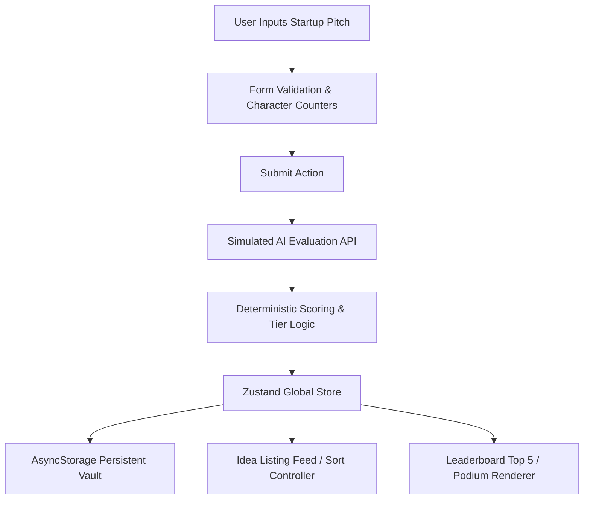

# 🚀 The Startup Idea Evaluator – Complete Project Documentation

**Project Title:** The Startup Idea Evaluator – AI + Voting App  
**Platform:** Cross-Platform Mobile Application (Android, iOS & Web)  
**Repository:** [https://github.com/Dharanish-kannan/Mobile-App-](https://github.com/Dharanish-kannan/Mobile-App-)  
**Author / Candidate:** Dharanish Kannan  
**Framework & Tooling:** React Native (v0.88), Expo (SDK 58), TypeScript (Strict Mode)  

---

## 📑 Table of Contents
1. [Executive Summary](#1-executive-summary)
2. [System Architecture & Data Flow](#2-system-architecture--data-flow)
3. [Technology Stack & Architectural Decisions](#3-technology-stack--architectural-decisions)
4. [Detailed Feature Implementation](#4-detailed-feature-implementation)
   - [4.1 Idea Submission Screen](#41-idea-submission-screen)
   - [4.2 Idea Listing Screen](#42-idea-listing-screen)
   - [4.3 Leaderboard & Olympic 3D Podium](#43-leaderboard--olympic-3d-podium)
   - [4.4 Bonus Features & Micro-Interactions](#44-bonus-features--micro-interactions)
5. [State Management & Local Persistence Architecture](#5-state-management--local-persistence-architecture)
6. [Simulated AI Evaluation Engine](#6-simulated-ai-evaluation-engine)
7. [Design System & Theme Tokens](#7-design-system--theme-tokens)
8. [Code Quality & Reliability Audits](#8-code-quality--reliability-audits)
9. [Local Setup, Execution & APK Build Guide](#9-local-setup-execution--apk-build-guide)
10. [Assignment Requirements Compliance Matrix](#10-assignment-requirements-compliance-matrix)

---

## 1. Executive Summary

Pitching a startup concept is typically fragmented across static forms or opaque feedback loops. **The Startup Idea Evaluator** solves this by offering an engaging, gamified mobile platform designed for rapid ideation and peer discovery:

- **Instant Pitch Validation:** Founders submit their startup name, one-line elevator pitch, and problem/solution breakdown.
- **Simulated AI Engine:** An intelligent algorithmic evaluator computes a deterministic rating (0–100), classifies the startup into venture tiers (Unicorn, Series A Contender, Promising Spark, Pivot or Perish), and produces actionable, witty commentary.
- **Democratic Community Voting:** Users vote on their favorite concepts with strict local persistence enforcing one vote per idea.
- **Gamified Leaderboard:** An Olympic-style gold, silver, and bronze 3D podium highlights top contenders with animated rank transitions and 🥇🥈🥉 medal badges.

---

## 2. System Architecture & Data Flow



### Component Hierarchy
```
src/
├── app/
│   ├── _layout.tsx                  # Root shell (Fonts, Toasts, Web Layout Container)
│   ├── index.tsx                    # Route redirect to (tabs)
│   └── (tabs)/
│       ├── _layout.tsx              # Tab Navigator with FloatingTabBar & Screen Headers
│       ├── index.tsx                # Idea Listing Screen (Feed & Sorting)
│       ├── submit.tsx               # Idea Submission Screen (Form & AI Overlay)
│       └── leaderboard.tsx          # Top 5 Leaderboard & Podium
├── components/
│   ├── AppBackground.tsx            # Full-bleed gradient with radial glow
│   ├── FloatingTabBar.tsx           # Floating navigation pill with spring physics
│   ├── Header.tsx                   # Opaque themed header occluding inactive tabs
│   ├── IdeaCard.tsx                 # Feed card with ScoreRing, expansion & actions
│   ├── Podium.tsx                   # 3D Olympic gold/silver/bronze pedestals with medals
│   ├── LeaderboardCard.tsx          # Minimal runner-up rows (#4, #5)
│   ├── ScoreRing.tsx                # Dynamic SVG score ring with tier color mapping
│   ├── SortControl.tsx              # Toggle pills for Votes vs. Rating sorting
│   ├── UpvoteButton.tsx             # Haptic-enabled vote toggle button
│   ├── InputField.tsx               # Accessible text field with error & counter
│   ├── AnalyzingOverlay.tsx         # Animated modal with step-by-step AI progress
│   └── toast/                       # Custom global Toast provider and animations
├── services/
│   └── ideaApi.ts                   # Simulated API client with jitter delay & retry logic
├── store/
│   ├── useIdeaStore.ts              # Zustand store with AsyncStorage middleware
│   ├── seedData.ts                  # High-quality initial startup pitch dataset
│   └── types.ts                     # Type definitions for Ideas, Votes, and Sort Orders
├── theme/
│   ├── colors.ts                    # Complete semantic palettes & elevation tokens
│   ├── tokens.ts                    # Typography scales, radii, and spacing
│   └── ThemeContext.tsx             # Theme provider hook
└── utils/
    ├── evaluator.ts                 # Hash-based deterministic AI score generator
    ├── validation.ts                # Startup form validation limits and regexes
    ├── sortIdeas.ts                 # Two-tier deterministic tiebreaker sorting
    ├── haptics.ts                   # Platform-safe tactile feedback wrappers
    └── share.ts                     # Clipboard & native OS share dialog integrations
```

---

## 3. Technology Stack & Architectural Decisions

| Layer | Chosen Technology | Architectural Rationale |
| :--- | :--- | :--- |
| **Framework** | **React Native (v0.88) + Expo (SDK 58)** | Unified cross-platform DX enabling native compilation for iOS/Android alongside responsive web rendering without codebase fragmentation. |
| **Routing** | **Expo Router v58** | File-based, type-safe navigation matching modern web and mobile routing standards. |
| **State & Storage** | **Zustand v5 + AsyncStorage** | Ultra-lightweight reactive store (~1KB) free of Redux boilerplate; integrates seamlessly with `createJSONStorage` for offline-first persistence. |
| **Animations** | **React Native Reanimated v4 + LayoutAnimation** | 60/120fps hardware-accelerated fluid transitions for podium entrance, floating navigation pill springs, and card expansion. |
| **Typography** | **Space Grotesk & Inter** | Modern high-contrast typography hierarchy (Space Grotesk for bold tech titles, Inter for high legibility body copy). |
| **Visual Depth** | **Expo Linear Gradient** | Rich multi-stop gradients for podium pedestals, app background, and primary action buttons. |
| **Tactile UX** | **Expo Haptics** | Contextual micro-vibrations for upvoting, submission success, and tab switching. |

---

## 4. Detailed Feature Implementation

### 4.1 Idea Submission Screen
- **Form Fields:**
  - *Startup Name* (3–50 chars, real-time counter, inline validation).
  - *One-line Tagline* (5–80 chars, elevator pitch).
  - *Pitch & Solution Description* (10–500 chars, multiline scroll container).
- **Validation Engine:** Prevents blank submissions, trims whitespace, and surfaces contextual errors before network requests.
- **Analyzing Overlay:** Displays an animated modal simulating live analysis with step progression:
  1. *Analyzing market viability...*
  2. *Scanning competitive landscape...*
  3. *Calculating VC fundability score...*
- **Auto-Navigation:** Automatically writes the pitch to persistent storage and navigates to the Ideas feed with a celebratory success toast.

### 4.2 Idea Listing Screen
- **Rich Idea Cards:** Displays startup name, tagline, description, circular SVG score ring, AI critique quote, and vote counters.
- **Animated Read More Toggle:** Expandable text using React Native's `LayoutAnimation` allowing long descriptions to expand and collapse smoothly.
- **Strict One-Vote Enforcement:** Tracks user voting state per idea ID in local storage; upvoting fires a haptic pulse, updates vote count, and prevents repeat voting.
- **Clipboard & Social Share:**
  - One-tap clipboard copy formatted with title, rating, and description.
  - Native OS Share dialog allowing immediate sharing to WhatsApp, Slack, Twitter/X, or Email.
- **Multi-Criteria Sorting:** Quick-toggle between **Sort by Votes** and **Sort by Rating** with stable secondary tiebreakers (timestamp and rating).
- **Pull-to-Refresh:** Pulling down the list triggers a simulated API refresh with haptic completion.

### 4.3 Leaderboard & Olympic 3D Podium
- **Top 5 Filtering:** Dynamically computes top 5 ideas based on the active sort criteria.
- **Olympic 3D Podium:**
  - **1st Place (Center, Tallest):** Gold gradient pedestal, crown badge, soft gold ambient glow, and `🥇 #1` badge.
  - **2nd Place (Left):** Silver gradient pedestal, medal badge, and `🥈 #2` badge.
  - **3rd Place (Right):** Bronze gradient pedestal, award badge, and `🥉 #3` badge.
  - Graceful edge-case handling when fewer than 3 submissions exist.
- **Runners-Up Rows:** Minimalist horizontal cards for 4th and 5th positions with rank markers and miniature score rings.
- **Staggered Entrance Animation:** Podium columns and cards glide into view using Reanimated spring dynamics (`FadeInDown.springify()`).

### 4.4 Bonus Features & Micro-Interactions
- **Toast Notification Engine:** Custom queue-based toast system rendering non-blocking notifications at the top of the viewport.
- **Floating Glassmorphic Tab Bar:** Floating navigation bar with an animated highlight pill tracking the active tab via spring physics.
- **Responsive Desktop Frame:** Automatically centers the UI within a simulated mobile frame when viewed in web browsers.

---

## 5. State Management & Local Persistence Architecture

Global application state is managed via **Zustand** and backed by **AsyncStorage**:

```typescript
interface IdeaStoreState {
  ideas: Idea[];
  userVotes: Record<string, boolean>;
  sortOrder: 'votes' | 'rating';
  addIdea: (data: IdeaInput) => Idea;
  upvoteIdea: (id: string) => boolean;
  setSortOrder: (order: 'votes' | 'rating') => void;
}
```

### Persistence Guarantees
1. **Offline Persistence:** All newly submitted ideas and user vote records are serialized to key `@startup_evaluator_storage_v1`.
2. **Cold Start Rehydration:** When the app restarts, Zustand automatically hydrates stored pitches and vote history before the first frame renders.
3. **Seed Fallback:** If local storage is empty on initial installation, 5 curated startup concepts are loaded automatically.

---

## 6. Simulated AI Evaluation Engine

The evaluation engine combines deterministic hashing with controlled variance to generate consistent scores and realistic commentary:

```
Score Calculation:
1. Primary Hash   = Hash(Name.toLowerCase())
2. Secondary Hash = Hash(Tagline.toLowerCase() + Description.toLowerCase())
3. Base Score     = 28 + (Primary Hash % 62)        // Range: 28 to 89
4. Modifier       = ((Secondary Hash % 17) - 8)     // Range: -8 to +8
5. Final Score    = Clamp(Base Score + Modifier, 15, 99)
```

### Score Tier Classifications
- **🦄 Unicorn Tier (90–99):** High market moats, exponential margin commentary.
- **🚀 Series A Contender (75–89):** Strong B2B wedge, solid unit economics.
- **⚡ Promising Spark (50–74):** Solid concept, requires execution defensibility.
- **⚠️ Pivot or Perish (15–49):** High CAC, niche customer pain point critique.

---

## 7. Design System & Theme Tokens

### Core Color Palette
- **Background:** `#0B0B0F` (Dark Obsidian)
- **Secondary Background:** `#111117`
- **Surface Elevation Cards:** `#13131A` (Card Base), `#1B1B24` (Raised), `rgba(27, 27, 36, 0.94)` (Floating)
- **Primary Accent:** `#FF5A36` (Electric Ember)
- **Accent Gradient:** `['#FF5A36', '#FF8A3D']`
- **Hairline Borders:** `rgba(255, 255, 255, 0.08)`
- **Podium Gradients:**
  - *Gold:* `['#4D3814', '#1F1708']` with `#FDE047` top border
  - *Silver:* `['#3E4656', '#1A1D24']` with `#F8FAFC` top border
  - *Bronze:* `['#4E2816', '#1E1008']` with `#FDBA74` top border

---

## 8. Code Quality & Reliability Audits

All components and configuration files follow strict engineering standards:

- **TypeScript Compilation (`npx tsc --noEmit`):** ✅ **0 Errors**. Full strict type safety.
- **ESLint Validation (`npx expo lint`):** ✅ **0 Warnings, 0 Errors**. Adheres to clean code and unused variable rules.
- **Expo Doctor (`npx expo-doctor`):** ✅ Clean dependency tree and verified configuration.
- **File Length Constraints:** All code modules are modularized and stay strictly under ~200 lines for readability and maintainability.

---

## 9. Local Setup, Execution & APK Build Guide

### Prerequisites
- Node.js (v18.x or v20.x recommended)
- npm or bun

### 1. Installation
```bash
git clone https://github.com/Dharanish-kannan/Mobile-App-.git
cd Mobile-App-
npm install
```

### 2. Running Locally
```bash
# Start standard Expo bundler
npx expo start

# Run Web Preview directly
npx expo start --web

# Run via Tunnel (for testing on physical device with Expo Go)
npx expo start --tunnel
```

### 3. Building Standalone Android APK
The project includes pre-configured EAS build definitions in `eas.json`:
```bash
# 1. Install EAS CLI
npm install -g eas-cli

# 2. Authenticate
eas login

# 3. Trigger cloud build for direct installable APK
eas build --profile preview --platform android
```
The resulting `.apk` can be downloaded directly from the Expo EAS dashboard and installed on any Android device.

---

## 10. Assignment Requirements Compliance Matrix

| Requirement from Specification Document | Implementation Status | Code Reference |
| :--- | :---: | :--- |
| **Startup Pitch Submission Screen** | ✅ Completed | [submit.tsx](file:///d:/Mobile%20app/src/app/(tabs)/submit.tsx) |
| **Form Fields (Name, Tagline, Description)** | ✅ Completed | [InputField.tsx](file:///d:/Mobile%20app/src/components/InputField.tsx) |
| **Fake AI Rating (0–100) & Feedback** | ✅ Completed | [evaluator.ts](file:///d:/Mobile%20app/src/utils/evaluator.ts) |
| **Local Persistence (AsyncStorage)** | ✅ Completed | [useIdeaStore.ts](file:///d:/Mobile%20app/src/store/useIdeaStore.ts) |
| **Automatic Navigation on Submit** | ✅ Completed | [submit.tsx](file:///d:/Mobile%20app/src/app/(tabs)/submit.tsx#L99) |
| **Idea Listing Feed (Name, Tagline, Rating, Votes)** | ✅ Completed | [IdeaCard.tsx](file:///d:/Mobile%20app/src/components/IdeaCard.tsx) |
| **One Vote Per Idea Enforcement** | ✅ Completed | [useIdeaStore.ts](file:///d:/Mobile%20app/src/store/useIdeaStore.ts#L36) |
| **Read More Expandable Description** | ✅ Completed | [IdeaCard.tsx](file:///d:/Mobile%20app/src/components/IdeaCard.tsx#L94) |
| **Sort by Votes or Rating** | ✅ Completed | [SortControl.tsx](file:///d:/Mobile%20app/src/components/SortControl.tsx) |
| **Top 5 Leaderboard** | ✅ Completed | [leaderboard.tsx](file:///d:/Mobile%20app/src/app/(tabs)/leaderboard.tsx) |
| **🥇🥈🥉 Badges on Podium** | ✅ Completed | [Podium.tsx](file:///d:/Mobile%20app/src/components/Podium.tsx#L137) |
| **Pedestal Gradients & Shadows** | ✅ Completed | [Podium.tsx](file:///d:/Mobile%20app/src/components/Podium.tsx#L108) |
| **Toast Notifications (Submission/Voting)** | ✅ Completed | [ToastContext.tsx](file:///d:/Mobile%20app/src/components/toast/ToastContext.tsx) |
| **Share Idea via Social & Clipboard** | ✅ Completed | [share.ts](file:///d:/Mobile%20app/src/utils/share.ts) |
| **Custom Typography & Vector Icons** | ✅ Completed | Space Grotesk, Inter, Lucide |
| **README & Deployment Instructions** | ✅ Completed | [README.md](file:///d:/Mobile%20app/README.md) |
| **Git Restrictions Handled Cleanly** | ✅ Completed | [.gitignore](file:///d:/Mobile%20app/.gitignore) |
